# Yakumama

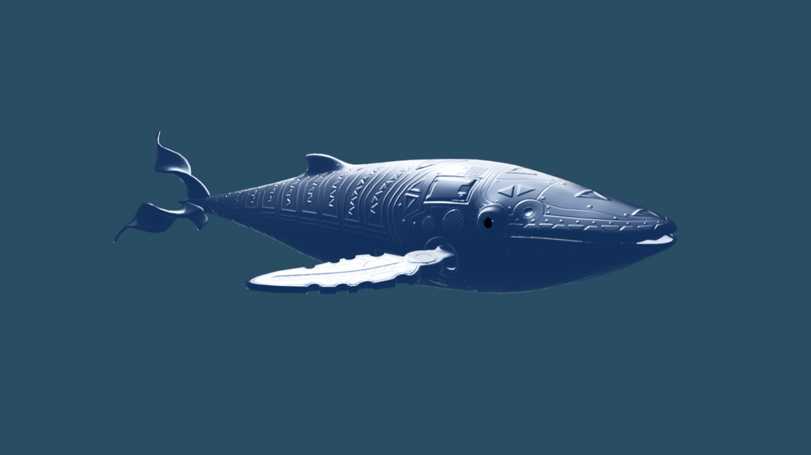

**A whale that learns to move from a human performer.** Yakumama is a 3D whale living in Blender. A performer sits
in front of a depth camera wearing a biometric sensor and acts her ten moods; the whale follows the performer's face,
hands and heartbeat live, and every performance is recorded as a dataset she is trained on.

Part of a series of characters driven by human performance (the llama, the gecko, the macaque). Built in Cochabamba.

## What it does

- **Live puppeteering.** OAK‑D camera → MediaPipe face mesh, 51 blendshapes and hand tracking → the whale's head,
  eyes, blinks, gaze, mouth and pectoral fins, 30 times a second.
- **Biometrics.** An EmotiBit on the performer's wrist streams pulse, skin conductance, skin temperature and motion
  straight to the recorder over WiFi. Her heart beats with the performer's; the pulse sets her tempo and energy,
  the skin conductance her tension.
- **Ten moods as real whale behaviours.** calm, singing, playful, curious, feeding, sad, angry, alert, diving,
  surfacing, each modelled on humpback behaviours documented by NOAA (logging, spyhopping, lobtailing, breaching,
  high‑fluking dive, lunge feeding…), each with its own facial expression, gaze and skin colour.
- **Mood recognition.** A classifier trained on the performer's takes reads the mood from the face and switches the
  whale's behaviour on its own.
- **Dataset.** Every take is saved as two JSON‑lines files, face and body, aligned frame by frame, ready for training.

```
 OAK-D ──► face / hands ──► grabador ──► UDP ──► receptor (Blender add-on) ──► whale
 EmotiBit (WiFi) ────────► grabador               body: NOAA behaviour of the mood
 recorded takes ──► reproducir ──► UDP            face: mood expression + performer's face on top
```

## See her move

**[▶ All ten moods, 2 min 20 s (mp4, 20 MB)](videos_comportamientos/16x9/todos_los_animos_16x9.mp4)** — rendered
with the neural net as performer, no camera: body on the left, face on the right, skin in the colour of the mood.

| calm | singing | playful | curious | feeding |
|---|---|---|---|---|
| 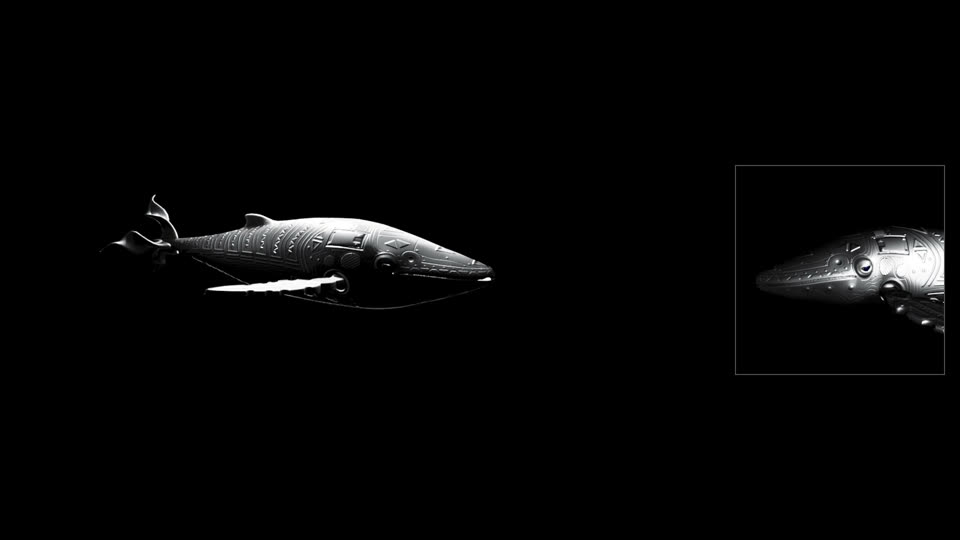 | 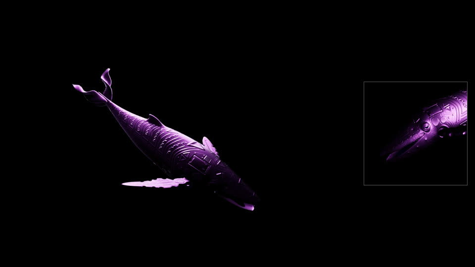 | 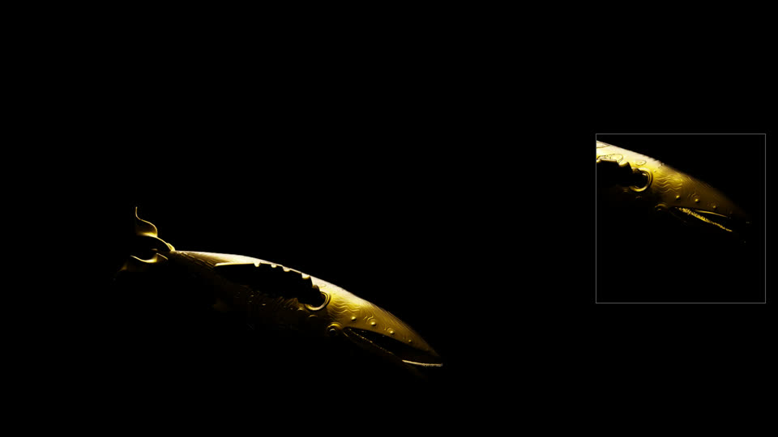 | 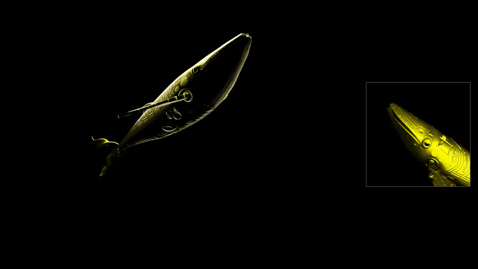 | 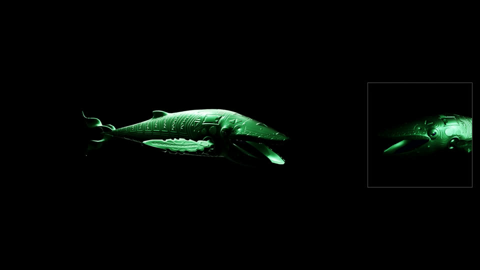 |

| sad | angry | alert | diving | surfacing |
|---|---|---|---|---|
| 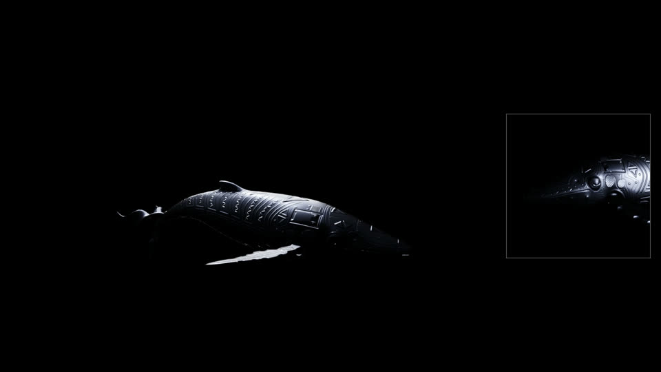 | 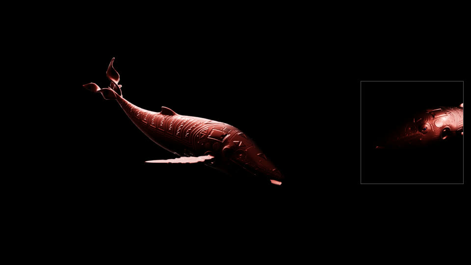 | 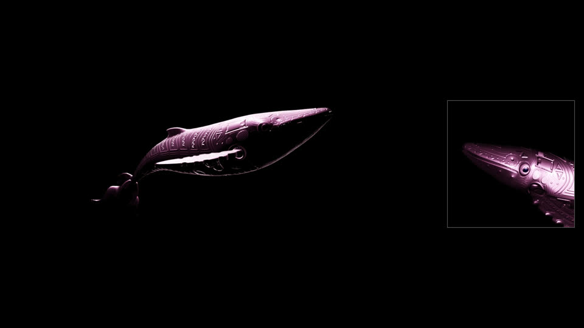 | 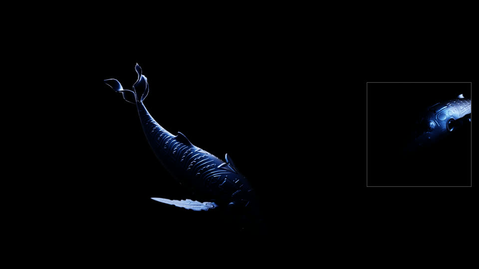 | 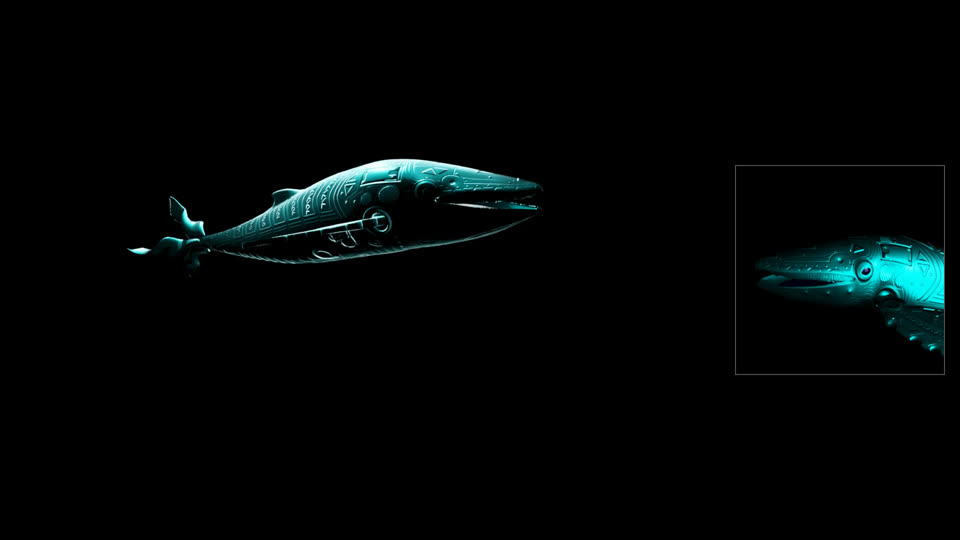 |

## Repository

| file | role |
|---|---|
| `grabar_ballena.py` | the recorder: runs the camera script, calibrates the face, links the EmotiBit, recognises the mood, serves a web control panel, writes the datasets |
| `receptor_ballena.py` | the whale: Blender script with the ten behaviours, the Ballena panel, the face/fin/pulse layers |
| `yakumama_receptor_addon.py` | Blender add-on that loads the receiver whenever `whale.blend` opens |
| `emotibit_cliente.py` | direct WiFi client for the EmotiBit (no Oscilloscope needed) |
| `entrenar_animo.py` | trains the mood recogniser from the datasets |
| `reproducir.py` | replays a recorded take on the whale |
| `Yakumama.command` | double-click launcher: Blender, recorder, panel |
| `docs/LOGICA.md` | the full logic, in Spanish |
| `referencias/noaa_comportamientos/` | the humpback behaviour references |

The datasets (≈ 250 MB) and the behaviour videos are not in the repository. The Blender file `whale.blend` and the
camera script `ballena3.py` live in the companion Huk project.

## The neural net

Same idea as the llama trainers, one step further. `entrenar_movimiento.py` learns the performer's own way of acting
each mood: input is the mood, the phase inside the take and harmonic time features plus the recent pulse; output is
what the performer did at that instant, head, mouth, blinks, brows, smile, gaze, both hands, pulse and skin
conductance (18 channels, 56 000 frames, PyTorch on the Apple GPU). `generar_animo.py <mood>` then runs the net
and feeds the whale those channels as if the performer were there: she acts the mood on her own, in the performer's
style, over the NOAA body behaviour. In Blender: choose a mood under Comportamiento and press **Actuar con la red**.
**Who she is for a visitor.** `entrenar_parecido.py` trains a second recogniser that says which recorded performer a
face and hands resemble most (90 % on held-out takes). The recorder decides it after two seconds of seeing someone, keeps
it for the whole encounter and sends it as `estilo`; the whale answers in that performer's style: the net fills the hands,
pulse and skin the visitor doesn't bring, and the body moves with that performer's energy. In Blender, *Estilo de* =
`auto` follows it; a name forces a style; `promedio` is the average whale.
**She keeps learning from the people who come.** Every person who sits in front of the camera is an *encounter*: the
recorder saves it on its own (`datasets/visitas/`, face, hands, pulse, the mood and the style she gave them; no images)
and remembers the person in `datasets/memoria.json` as a signature of 210 distances between points of the face mesh,
taken with the face at rest (`memoria.py`). If they come back she knows them within seconds, says so on the panel
("te conozco · visita 3") and greets them with the style she used the last time. Nothing is saved while a named
performer is recording. `aprender.py` retrains the mood recogniser with the windows where she was sure of a visitor's
mood (never more than half the set), so she gets better with every day of the installation; `python memoria.py` lists
who she knows and `python memoria.py olvidar v0003` forgets someone, as does the **Olvidar** button on the panel.
The memory stays on this Mac, is never in a package, and a sign at the installation should say she remembers.
Since the third session the net also takes **who is acting** as an input: in Blender, the field *Estilo de* next to
**Actuar con la red** takes a performer's name (violeta, sanam, suri, dan) or `promedio`, the average of all of them.
The mood recogniser (`entrenar_animo.py`, random forest on 2‑second windows) is the other learned piece.

## The JEPA (16 Oct, first version)

`jepa_datos.py` joins everything into one 24‑channel sequence per take at 12 fps with a mask: the four performers' faces,
hands and pulse (113 min), the llama session with Violeta's torso (35 min) and 239 Paqarina dancer skeletons translated
into body qualities (292 min, `cuerpo_cualidades.py`). `jepa_entrenar.py` trains a small JEPA (context 4 s → latent →
predicted latent of the next 2 s, decoded as a change from the last frame; modalities hidden at random in the context
so it learns face→body and body→face). `yakumama_jepa.py` runs it in NumPy; `generar_animo.py --jepa` makes her act a
mood by chaining 2 s predictions.

Honest numbers, held‑out takes: at 1 s ahead it ties "repeat the last frame" (blink is the only channel it beats) and
beats the channel mean everywhere; it keeps the mouth–head relation of singing (real −0.35, predicted −0.27) better than
earlier versions; face→body, learned only from the llama session, is not yet better than guessing the mean. Chained
generation is smooth but drifts toward stillness. What would change this: body and face recorded together (pose in the
recorder), more minutes per person, and sampling instead of the mean when generating.

## Hardware

Luxonis OAK‑D · EmotiBit MD‑V7 on an Adafruit Feather ESP32 · Apple Silicon Mac · Blender 5.1 · Python 3.11 with
depthai, mediapipe, scikit‑learn and PyTorch.

## Status (October 2026)

Four performers (137 min over the ten moods, incl. Violeta's llama session), 18 RAVDESS actors (six moods each) and
six BEAT speakers (face and body together, JEPA only). The mood recogniser reaches 37 % with one person held out
(chance 10 %; 24 % with four people, 35 % with 17). The resemblance between the four performers stays at 90 %. The
JEPA now trains on 823 minutes from five sources; it is still a research line (see below).

---

# Guía de uso (español)

## Arrancar todo con un doble clic
`Yakumama.command` (doble clic en el Finder) abre Blender con `whale.blend` y el receptor ya cargado, el EmotiBit
Oscilloscope, ollama, el grabador y el **panel web** en `http://localhost:8765`: botones grandes para ánimo, grabar,
guardar tramo, neutral y modo, con estado en vivo (cara vista, neutral, Blender recibiendo, EmotiBit, segundos por
ánimo). Hace lo mismo que las teclas. En el Oscilloscope hay que marcar Output List > OSC a mano.

## El panel Ballena siempre está
`yakumama_receptor_addon.py` está instalado como add-on de Blender (`~/Library/Application Support/Blender/5.1/scripts/addons/`,
activado en las preferencias): cada vez que se abre `whale.blend`, de donde sea, carga `receptor_ballena.py` solo.
No hace falta pegar nada ni usar el launcher para tener el panel y la ballena escuchando. Si se cambia de versión
de Blender, copiar el archivo a la carpeta de add-ons de la nueva versión y activarlo en Preferences > Add-ons.

## Arrancar la ballena (a mano)
```bash
/Applications/Blender.app/Contents/MacOS/Blender ~/Desktop/Huk/whale.blend     # y correr el receptor (Text.017)
ollama serve
cd ~/Desktop/Yakumama && venv/bin/python grabar_ballena.py                     # = python ballena3.py + grabador
```
`grabar_ballena.py` arranca `ballena3.py` sin modificarlo: Blender recibe todo igual, y cada paquete se copia
etiquetado con el ánimo que escribís en la terminal (`1`–`0`, `g` graba, `f` cierra el tramo, `r` resumen, `q` sale;
una tecla por vez, sin Enter).
Necesita la **OAK-D enchufada** (sin ella `ballena3.py` se cae en `dai.Device`).

## Modo SOLO CARA (para grabar la cara con la ballena quieta)
`receptor_ballena.py` es el receptor de Blender (`Text.017` de `whale.blend`) más un modo en que la ballena se queda
en su lugar y solo la cara sigue al actor: cabeza (nariz), boca (`jaw_open`, rango completo, ignora el slider Mouth),
parpadeo (`blink`), ojos hacia donde apunta la nariz, cejas (`brow_up` → asombrado, `brow_down` → angry) y
`mouth_sad` → sad. Sin poses de ánimo, ola de nado, aletas, turbina ni nado automático.
1. En Blender: Text editor > Open > `~/Desktop/Yakumama/receptor_ballena.py` > Run Script (Alt+P). Reemplaza al
   receptor que esté corriendo (no hace falta reiniciar Blender). Sin este modo se comporta igual que `Text.017`.
2. En la terminal de `grabar_ballena.py`: `c` enciende/apaga el modo (marca cada paquete con `solo_cara: 1`).
   El dataset se graba igual con o sin el modo: `solo_cara` no se guarda.
   `c` cicla: cuerpo entero → solo cara (la cabeza sigue la nariz) → solo cara con **cabeza fija** (solo boca,
   parpadeo y cejas, para ver la cara de frente) → cuerpo entero.
   `a` = ANCLADA (modo cuerpo): la ballena se mueve (poses, aletas, columna, cabeza) pero no viaja por el espacio:
   ni la mano, ni el joystick, ni el nado automático mueven su posición. Para grabar movimiento sin que se vaya.
   Alas: en modo cuerpo cada mano del actor levanta o baja la aleta de su lado (altura de la palma en cámara). Si
   la mano izquierda mueve la aleta derecha, poner `ALAS_CRUZADAS = True` en `receptor_ballena.py`.
   Latido: con el EmotiBit puesto, el cuerpo de la ballena late al ritmo del corazón del actor (`emotibit_hr`,
   un 3.5 % de escala en `spine.001`). También al reproducir un tramo grabado.
3. `n` = NEUTRAL: mirá a la cámara con la cara relajada y escribí `n`; toma 1 s de muestras y desde ahí cabeza, cejas,
   boca y parpadeo se miden respecto a esa cara. Sin esto, con la OAK-D de costado el yaw queda pegado en -1 (el
   receptor lo recorta ahí) y la ballena no sigue. Se aplica a lo que ve Blender y a `datasets/cara` (`todo` guarda
   el paquete crudo). Volvé a escribir `n` si movés la cámara o te sentás distinto. Si la cámara no ve la cara (valores congelados)
   el neutral se rechaza y hay que repetirlo.
Las líneas `yaw:...` de `ballena3.py` se esconden; el grabador imprime su propia línea de estado cada 2 s.

**Lengua y 52 blendshapes.** `grabar_ballena.py` corre el Face Landmarker (`modelos/face_landmarker.task`) sobre el
mismo cuadro de la OAK-D que `ballena3.py` le pasa a FaceMesh, sin tocar `ballena3.py`. Agrega al paquete (y a
`datasets/cara`): `tongue_out`, `mouth_smile`, `blink_l`, `blink_r`, `blink` (el mejor de los dos, reemplaza al de
ballena3, que casi siempre era 0) y `face_<nombre>` con los 52. En modo solo cara, `tongue_out` saca la lengua
(empuja la raíz hacia adelante y abre un poco la boca). Si tarda más de 20 ms por cuadro, corre cuadro por medio.

## La ballena reconoce el ánimo del actor
`venv/bin/python entrenar_animo.py` entrena un reconocedor (random forest sobre ventanas de 2 s: 51 blendshapes,
cabeza y manos) con todo `datasets/` y lo guarda en `modelos/animo_rf.pkl`. Con ese archivo presente, el grabador lo
corre en vivo: cada 0.5 s decide el ánimo que ve en tu cara (cambia solo si gana 3 veces seguidas) y se lo manda al
receptor como `actor_animo`, que entonces usa ese ánimo entero, sin mezclar con colores ni cerebro. El panel muestra
"La ballena ve". Acierto dentro de sesión ~75 %; entre sesiones distintas todavía ~5 % (falta una tercera sesión con
la cámara de frente y neutral tomado para que generalice).

## Videos de los comportamientos
`videos_comportamientos/16x9/` tiene un video por ánimo (cuerpo entero a la izquierda, cara a la derecha, fondo negro) y
`todos_los_animos_16x9.mp4` con los diez seguidos (2 min 20 s, está en el repo); la red neuronal hace de actor. Ver su README.

## Ver un tramo en la ballena
`venv/bin/python reproducir.py playful_001` manda el tramo a Blender con su tiempo original (`--modo cara|fija|cuerpo|anclada`,
`--velocidad 2`, `--loop`). Cerrar antes el grabador (`q`) para que no manden los dos a la vez.

## Grabar a otra persona
En el panel (http://localhost:8765) escribir el nombre en **quien actua** y apretar **Cambiar actor** (o arrancar con
`--actor nombre`). Los tramos se guardan como `<animo>_<actor>_NNN.jsonl` (los míos, sin actor, siguen siendo
`<animo>_NNN`) y cada línea lleva `"actor"`. Al cambiar de actor se cierra el tramo en curso y hay que tomar el
**Neutral** con la cara nueva antes de grabar. `entrenar_animo.py` mide además el acierto con un actor entero fuera.

## El cuerpo también (desde el 16 oct)
El grabador corre además MediaPipe Pose sobre el mismo cuadro de la OAK‑D y saca las cualidades con que los bailarines
conducen a la ballena: `cuerpo_pitch` (inclinación), `cuerpo_roll`, `cuerpo_yaw` (giro), `cuerpo_profundidad`
(agachado/salto), `cuerpo_energia`, `cuerpo_suavidad`. Van en cada paquete (la ballena las usa en vivo), en `cuerpo/`
de cada toma (cara y cuerpo juntos, lo que el JEPA necesitaba) y en el panel ("Cuerpo"). `--pose 0` lo apaga.

## Cómo se siente la persona (autoinforme)
Antes de cada toma, en el panel: dos deslizadores de 0 a 10, **desagradable ↔ agradable** (valencia) y **calma ↔ activada**
(activación), y **Guardar cómo me siento**. Van en cada línea de `cuerpo/` como `auto_valencia` y `auto_activacion`,
junto al pulso y la piel, y se borran al guardar el tramo para que la toma siguiente vuelva a preguntar.

## Qué se graba
- `datasets/cara/<ánimo>_NNN.jsonl`: head_yaw, head_pitch, jaw_open, blink, brow_up, brow_down, mouth_sad (y el
  paquete entero en `todo`).
- `datasets/cuerpo/<ánimo>_NNN.jsonl`: water, joy_x/joy_y/joy_btn, temp, humidity, pressure, l_palm_x/y, l_depth,
  cyber_*: todo lo que mueve columna, aletas, turbina y profundidad.
- EmotiBit: el grabador se conecta **directo al EmotiBit por WiFi** (`emotibit_cliente.py`: hello, conectar, ping,
  parseo de los paquetes CSV del firmware; hr del firmware o por picos del PPG). No hace falta el Oscilloscope ni
  OSC. Cada línea de `cuerpo` lleva `emotibit_<señal>` (eda, edl, ppg_ir/red/grn, therm, temp, acc/gyro/mag, hr,
  ibi, scr_*) solo si llegó un dato en los últimos 2 s (nunca repite valores viejos). `--emotibit-ip 192.168.50.64`
  si no lo encuentra por broadcast; `--emotibit-directo 0` para usar OSC del Oscilloscope (puerto 12345) en su lugar.
  El panel web muestra pulso, conductancia y ritmo cardíaco en vivo. Si el EmotiBit se queda colgado, con el Feather
  por USB se reinicia solo (`venv/bin/python -c "import serial..."`, ver sesión) o con el botón reset.
- `datasets/video/<ánimo>_NNN.mov`: la ventana de Blender grabada de `g` a `f` (screencapture), mismo nombre que el
  tramo; cada línea de cara y cuerpo lleva `video_t` (segundos desde que arrancó el video) para alinear. La primera
  vez macOS pide permiso de Grabación de pantalla para la Terminal. Apagado por defecto: `--video 1` lo enciende.
- `datasets/cara_webcam/<ánimo>_NNN.jsonl`: con `grabar_cara.py`, sin OAK-D: los 52 blendshapes de MediaPipe más la
  pose de la cabeza, y el mismo paquete de cara para Blender. Sirve para grabar la cara con más detalle o cuando la
  OAK-D no está. No correrlo junto con `ballena3.py` (los dos mandan al 9998).

Ánimos (los de `MOOD_KEYS` de `ballena3.py`): calm, singing, playful, curious, feeding, sad, angry, alert, diving,
surfacing. Meta: 60 s por ánimo. `python resumen.py` muestra cuánto hay.

## Mejor que la llama
La llama guardaba 23 números elegidos a mano y se enganchaba al mismo puerto que Blender. Aquí se guarda el paquete
entero, con la cara y el cuerpo separados pero con el mismo reloj y el mismo nombre de archivo, y la webcam agrega
52 blendshapes. Los entrenadores de la llama (`train_llama_body.py`, `train_llama_motion.py`) leen JSONL por línea con
claves con nombre: estos archivos se pueden leer igual cambiando la lista de claves.
